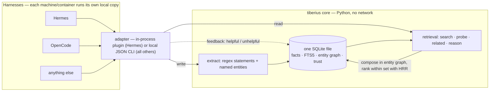

# Tiberius Memory

[](LICENSE)
[](pyproject.toml)
[](.github/workflows/tests.yml)

Local SQLite memory engine: structured facts, FTS5 search, entity graph, trust scoring, and
HRR-based compositional retrieval. Harness-agnostic core with one adapter per harness —
**no network, no service**: every harness runs the engine locally against its own DB file.

Tiberius is a fork of [hermes-plugin-holographic](https://github.com/NousResearch/hermes-plugin-holographic)
(Nous Research, MIT) — the HRR core is kept, but it is decoupled from a single harness: it runs
in-process under Hermes, and over a local CLI under OpenCode (and any other harness). See
[What's changed](#whats-changed-vs-upstream).

## Why this exists

- **Completely local.** Everything lives in one SQLite file on your machine. No network calls,
  no cloud, no API keys, no telemetry — your memory never leaves the box.
- **Free.** MIT-licensed, stdlib-only core (NumPy optional), nothing to bill per token or
  per seat.
- **Multiple harnesses, one memory model.** A single harness-agnostic core with one thin
  adapter per harness (Hermes in-process, OpenCode native plugin, anything else over a local
  CLI). Each harness keeps its own DB file — there is no central memory server to point
  containers at.
- **A real retrieval bug fixed.** The upstream HRR algebra could not compose queries across
  entities (see [What's changed](#whats-changed-vs-upstream)); that fix plus a
  golden-query eval gate is the reason the fork exists.

## How it works

Two paths over one local SQLite file: the **write path** extracts statements
and named entities from session content into the store; the **read path**
composes results in the SQL entity graph (which facts connect which
entities) and ranks within that set with HRR phase-vector similarity when
NumPy is available — without it, FTS5 + keyword scoring only.



Files:

- `store.py` — fact store (SQLite + FTS5), entity extraction, regex statement extraction
- `retrieval.py` — search / probe / related / reason (SQL entity graph composes, HRR ranks within set)
- `holographic.py` — HRR phase-vector algebra (numpy optional; without it, keyword mode)
- `provider.py` — Hermes `MemoryProvider` adapter (in-process plugin)
- `cli.py` — generic entrypoint for every other harness (`python3 -m tiberius.cli`)
- `opencode/` — native OpenCode V2 TypeScript plugin (wraps the CLI locally)
- `eval/` — golden-query recall harness (18 queries over a committed synthetic fixture; CI runs it on every push)

## What's changed vs upstream

- **HRR algebra fix**: fact vectors are lossy bundles of content + entity parts, so unbinding a
  phase key from a bundle is meaningless. Composition (probe/related/reason) now happens in the
  SQL entity graph; HRR only ranks within the composed set.
- **Compositional `reason()`**: facts connecting multiple named entities, ranked by shared-entity
  count — the query class the upstream could not answer at all.
- **Standalone core**: `store.py`/`retrieval.py`/`holographic.py` have no hard dependency on any
  harness (stdlib-only fallbacks; numpy optional).
- **Harness adapters**: `provider.py` (Hermes, in-process), `cli.py` (generic JSON CLI),
  `opencode/` (native OpenCode V2 plugin with per-session context injection and session-end
  extraction).
- **Quality gates**: 54 tests + an 18-query golden recall eval (`eval/`) that any retrieval
  change must not regress (fixture baseline recall@1 18/18, recall@3 18/18).

## Prerequisites

**Python 3.11+** — required for both harness paths (Hermes runs on it; the
OpenCode plugin shells out to `python3`). CPython ships the `sqlite3` module,
which is the engine Tiberius reads and writes with — **there is no separate
SQLite to install**: the store is a file, not a service.

Getting Python, if you don't have it:

- macOS: `brew install python`
- Debian/Ubuntu: `sudo apt install python3`
- OpenCode container: make sure `python3` is in the image (e.g.
  `apt-get install -y python3`)

Verify: `python3 -c "import sqlite3; print(sqlite3.sqlite_version)"`

Optional:

- **NumPy** — `pip install numpy`. Without it the engine degrades to keyword
  mode (FTS5 + Jaccard; entity composition still works via SQL, HRR reranking off).
- **`sqlite3` CLI** — only if you want to inspect the DB without Python
  (the [Your data](#your-data) snippet works with stdlib alone):
  macOS ships it; Debian/Ubuntu `sudo apt install sqlite3`; Alpine `apk add sqlite`.

## Hermes

Hermes discovers plugins by scanning `$HERMES_HOME/plugins/` (default `~/.hermes/plugins/`)
for a directory with a `plugin.yaml`. `name: tiberius` in that file is the identifier;
`provider.py` implements the `MemoryProvider` contract, which is what `hermes memory
setup` lists.

```bash
git clone https://github.com/Greg-GB/tiberius ~/.hermes/plugins/tiberius
```

Enable it in `config.yaml`:

```yaml
plugins:
  enabled: [tiberius]
```

Then pick it as your memory provider:

```bash
hermes memory setup    # select "tiberius"
```

Config in `config.yaml` under `plugins.tiberius`:

| Key | Default | Description |
|-----|---------|-------------|
| `db_path` | `$HERMES_HOME/tiberius_store.db` | SQLite database path |
| `auto_extract` | `false` | Auto-extract facts at session end |
| `default_trust` | `0.5` | Default trust score for new facts |
| `hrr_dim` | `1024` | HRR vector dimensions |

## Your data

The store is a single SQLite file, created automatically on first use —
nothing to install or provision. Where it lives:

| Harness | Default location | Override |
|---------|------------------|----------|
| Hermes | `$HERMES_HOME/tiberius_store.db` | `plugins.tiberius.db_path` in `config.yaml` |
| OpenCode | `~/.tiberius/memory.db` | `options.db` in `opencode.json` |

To move your memory, move the file. To inspect it, use any SQL tool — no
`sqlite3` CLI needed; Python's stdlib (a requirement anyway) does it.
Node.js users: the file is plain SQLite in WAL mode — open it directly
(e.g. with `better-sqlite3`, read-only) for standard SQL and FTS5 queries;
full retrieval quality (HRR reranking) lives in the Python CLI.

```bash
python3 -c "
import sqlite3
for r in sqlite3.connect('tiberius_store.db').execute(
        'SELECT fact_id, content, trust_score FROM facts ORDER BY fact_id DESC LIMIT 10'):
    print(r)
"
```

## OpenCode (native V2 plugin)

In the OpenCode container (or baked into its image):

```bash
git clone https://github.com/Greg-GB/tiberius /opt/tiberius
pip install numpy                # optional: HRR reranking
```

`opencode.json`:

```jsonc
{
  "plugins": [{
    "package": "file:///opt/tiberius/opencode",
    "options": {
      "db": "/opt/tiberius/memory.db",      // default: ~/.tiberius/memory.db
      "pythonpath": "/opt"                  // repo parent, so package `tiberius` imports
    }
  }]
}
```

The plugin gives the agent `memory_search` / `memory_probe` / `memory_add` tools, injects the
top relevant facts into the system prompt on each session's first model call, and regex-extracts
facts from user messages when a session finishes. No cross-container traffic — the engine runs
in the same container as OpenCode.

## Any other harness

The repo dir must be importable as package `tiberius` (its parent on `PYTHONPATH`), then:

```bash
python3 -m tiberius.cli --db PATH search "query" [--top N]
python3 -m tiberius.cli --db PATH probe "entity"
python3 -m tiberius.cli --db PATH related "entity"
python3 -m tiberius.cli --db PATH reason "a" "b"
python3 -m tiberius.cli --db PATH add "fact" [--category C] [--tags a,b]
python3 -m tiberius.cli --db PATH feedback <id> helpful|unhelpful
echo '[{"role":"user","content":"..."}]' | python3 -m tiberius.cli --db PATH extract
```

DB path: `--db` > `$TIBERIUS_DB` > `~/.tiberius/memory.db`. All output is JSON.

### For agents

The tool descriptions say what each operation does;
[skills/tiberius-usage/SKILL.md](skills/tiberius-usage/SKILL.md) says how to
use them *well* — when to recall, what to store, and the feedback loop that
keeps the store accurate. Install it by copying the file into your agent's
skills directory (or referencing it from your agent instructions).

## Contributing

See [CONTRIBUTING.md](CONTRIBUTING.md) — the one rule that matters: retrieval
changes must not regress the golden eval (fixture baseline recall@1 18/18, recall@3 18/18).
AI coding agents: [AGENTS.md](AGENTS.md).

## Development

Core tests (`test_tiberius_store`, `test_tiberius_retrieval`, `test_tiberius_cli`) need nothing
beyond Python 3.11+ and pytest; provider tests additionally import Hermes core. Retrieval
quality is gated by the golden eval: `python eval/run_eval.py` runs the committed
synthetic fixture (fixture baseline recall@1 18/18, recall@3 18/18); pass a DB path to
eval against your own live store: `python eval/run_eval.py /path/to/your.db`. CI runs
the core suite + fixture eval on every push.
