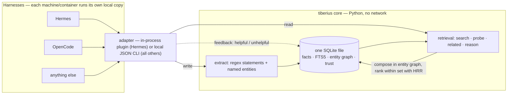

# Tiberius Memory

[](LICENSE)
[](pyproject.toml)
[](.github/workflows/tests.yml)

Local SQLite memory engine: structured facts, skill retrieval, FTS5 search, entity graph, trust
scoring, and HRR-based compositional retrieval. Harness-agnostic core with one adapter per
harness — **no network, no service**: every harness runs the engine locally against its own
DB file.

Tiberius is a fork of [hermes-plugin-holographic](https://github.com/NousResearch/hermes-plugin-holographic)
(Nous Research, MIT) — the HRR core is kept, but it is decoupled from a single harness: it runs
in-process under Hermes, and over a local CLI under OpenCode (and any other harness). The original
repo is archived; the upstream project continues at
[itpartypattaya/hermes-plugin-holographic](https://github.com/itpartypattaya/hermes-plugin-holographic).
See [What's changed](#whats-changed-vs-upstream).

## A note on provenance

Tiberius was developed alongside a local LLM (an AI coding agent) and human
review. The whole codebase is small enough to read in one sitting, and every
push is gated in CI by the core test suite, the plugin unit tests, and a
19-query golden recall eval. But it will
store **your personal memory**: read the code and verify the parts you rely
on before you trust it with your data.

## Why this exists

- **Completely local.** Everything lives in one SQLite file on your machine. No network calls,
  no cloud, no API keys, no telemetry — your memory never leaves the box.
- **Free.** MIT-licensed, stdlib-only core (NumPy optional), nothing to bill per token or
  per seat.
- **Multiple harnesses, one memory model.** A single harness-agnostic core with one thin
  adapter per harness (Hermes in-process, OpenCode native plugin, anything else over a local
  CLI). Each harness keeps its own DB file — there is no central memory server to point
  containers at.
- **A real retrieval bug fixed.** The upstream HRR algebra could not compose queries across
  entities (see [What's changed](#whats-changed-vs-upstream)); that fix plus a
  golden-query eval gate is the reason the fork exists.

## How it works

Two paths over one local SQLite file: the **write path** extracts statements
and named entities from session content into the store; the **read path**
composes results in the SQL entity graph (which facts connect which
entities) and ranks within that set with HRR phase-vector similarity when
NumPy is available — without it, FTS5 + keyword scoring only.



Files:

- `store.py` — fact store (SQLite + FTS5), entity extraction, regex statement extraction
- `retrieval.py` — search / probe / related / reason (SQL entity graph composes, HRR ranks within set)
- `brief.py` — `brief`: the token-budgeted context pack (search ∪ probe, tiered rank, budget fill) — the shared implementation behind the CLI subcommand, the OpenCode tool, and the Hermes provider action
- `drift.py` — `drift`: the two-sided plan/state comparison pack (exact tag+entity plan query, recency-ranked state window, overlap-coefficient echo markers) — read-only recall-and-assembly; the agent judges drift, the core never scores it (design: `docs/drift.md`)
- `holographic.py` — HRR phase-vector algebra (numpy optional; without it, keyword mode)
- `provider.py` — Hermes `MemoryProvider` adapter (in-process plugin)
- `cli.py` — generic entrypoint for every other harness (`python3 -m tiberius.cli`)
- `opencode/` — native OpenCode V2 TypeScript plugin (wraps the CLI locally)
- `eval/` — golden-query recall harness (19 queries over a committed synthetic fixture; CI runs it on every push)

## What's changed vs upstream

- **HRR algebra fix**: fact vectors are lossy bundles of content + entity parts, so unbinding a
  phase key from a bundle is meaningless. Composition (probe/related/reason) now happens in the
  SQL entity graph; HRR only ranks within the composed set.
- **Compositional `reason()`**: facts connecting multiple named entities, ranked by shared-entity
  count — the query class the upstream could not answer at all.
- **Standalone core**: `store.py`/`retrieval.py`/`holographic.py` have no hard dependency on any
  harness (stdlib-only fallbacks; numpy optional).
- **Harness adapters**: `provider.py` (Hermes, in-process), `cli.py` (generic JSON CLI),
  `opencode/` (native OpenCode V2 plugin with per-turn context injection — on by default —
  and session-end extraction).
- **Full operation parity**: every adapter exposes the same surface — search / probe /
  show / entities / drift / related / reason, plus CRUD and hygiene (`add`,
  `add_batch`, `update`, `remove`, `supersede`, `merge`, `hygiene`, `list`, `stats`, `contradict`,
  `feedback`) and session handoff (`checkpoint`, `docs/checkpoint.md`). `list`,
  `search`, and `brief` take `--since` time filtering (`created_at` at or
  after; `docs/since.md`) and `--categories` / `--exclude-category` pool
  filtering (`docs/search-categories.md`). Every adapter also has
  `brief` (the token-budgeted task context pack) — a CLI subcommand, the
  OpenCode `memory_brief` tool, and the Hermes provider's
  `fact_store(action='brief')` — one shared implementation (`docs/brief.md`).
- **Skill catalog**: the harness's skills as a second memory corpus — `skill-sync`
  upserts each `SKILL.md` as a `skill`-category fact, both adapters inject a ranked
  skill block (trust floor at session start + per-turn search), and session-end usage
  feedback trains the ranking. Opt-in per harness (`skillDirs` / `skill_dirs`); unset
  is zero behavior change. Design: `docs/skill-retrieval.md`.
- **Discovery passes**: alias expansion and prefix fallback in retrieval, so near-miss
  and partial queries still land the right fact.
- **Near-duplicate detection**: `add` reports `possible_duplicates` (token-overlap over
  the FTS candidate pool) — report-only, the caller removes if it agrees; the store
  never blocks a write.
- **Provenance**: every write records who wrote it (`origin` on `facts` — the
  profile:session runtime tag for the provider, `cli` for CLI writes,
  `skill-sync`, `opencode`). Recall actions take `origin` / `exclude_origin`
  (NULL-safe: legacy rows survive exclusion), `stats` reports the per-origin
  breakdown, and `show`/`list` rows carry the field for audit
  (`docs/provenance.md`).
- **Merge**: `merge` folds one fact into another — the from row is deleted,
  its content concatenated onto the survivor, trust = max, entities and tags
  = the union. One transaction: a failure anywhere rolls back, so no entity
  link is ever silently dropped (the hazard of `update` + `remove`). The
  survivor's fact_id is returned with the merged row; superseded facts
  can't participate. CLI `merge <from> <into>`, OpenCode `memory_merge`,
  provider `fact_store(action='merge')` (`docs/merge.md`).
- **Hygiene**: `hygiene` is the store health report — orphan entities
  (≤1 linked fact), near-duplicate clusters (the same detector `add` runs),
  oversized facts (over 200 words by default), low-trust facts (below 0.45
  by default, no helpful feedback), and the superseded count. Read-only,
  sections capped at 20 items with their total counts — the mess, and how
  big it is. The only auto-fix is `hygiene --apply orphans` (CLI), which
  prunes entities with zero linked facts; single-fact entities are just
  young. Every fact-level fix is made with the report in hand (`docs/hygiene.md`).
- **Pool telemetry**: every FTS `search` counts its final candidate pool into a
  daily row (`pool_stats` — one row per UTC day: searches, zero-pools,
  pool-size aggregates). `stats` reports the trailing-7-day section
  (`zero_pool_rate`, `avg_pool`, `max_pool`) — the production input for the
  gated semantic-recall decision. No query text stored; add-time duplicate
  detection and the hygiene scan don't count (`docs/pool-counters.md`).
- **Episodic decisions**: a convention, not an engine. Decisions and dated
  events are stored with category `episodic` and the content shape
  `YYYY-MM-DD: <decision> — <alternatives> — <reason>` (one line; the date
  prefix is the first token, which is what makes date or topic search work).
  Recall uses the existing surfaces: `list --category episodic --since
  <date>` is the decision timeline, `search` and `probe` work as usual. No
  code — the guard test pins the shape (`docs/episodic-convention.md`).
- **Quality gates**: the core test suite (runs anywhere — `python -m pytest -q`),
  the plugin unit tests, Hermes-provider tests (need a Hermes environment), and
  a 19-query golden recall eval (`eval/`) that any retrieval change must not
  regress (fixture baseline recall@1 19/19, recall@3 19/19).

## Prerequisites

**Python 3.11+** — required for both harness paths (Hermes runs on it; the
OpenCode plugin shells out to `python3`). CPython ships the `sqlite3` module,
which is the engine Tiberius reads and writes with — **there is no separate
SQLite to install**: the store is a file, not a service.

Getting Python, if you don't have it:

- macOS: `brew install python`
- Debian/Ubuntu: `sudo apt install python3`
- OpenCode container: make sure `python3` is in the image (e.g.
  `apt-get install -y python3`)

Verify: `python3 -c "import sqlite3; print(sqlite3.sqlite_version)"`

Optional:

- **NumPy** — `pip install numpy`. Without it the engine degrades to keyword
  mode (FTS5 + Jaccard; entity composition still works via SQL, HRR reranking off).
- **`sqlite3` CLI** — only if you want to inspect the DB without Python
  (the [Your data](#your-data) snippet works with stdlib alone):
  macOS ships it; Debian/Ubuntu `sudo apt install sqlite3`; Alpine `apk add sqlite`.

## Hermes

Hermes discovers plugins by scanning `$HERMES_HOME/plugins/` (default `~/.hermes/plugins/`)
for a directory with a `plugin.yaml`. `name: tiberius` in that file is the identifier;
`provider.py` implements the `MemoryProvider` contract, which is what `hermes memory
setup` lists.

```bash
git clone https://github.com/Greg-GB/tiberius ~/.hermes/plugins/tiberius
```

Enable it in `config.yaml`:

```yaml
plugins:
  enabled: [tiberius]
```

Then pick it as your memory provider:

```bash
hermes memory setup    # select "tiberius"
```

Config in `config.yaml` under `plugins.tiberius`:

| Key | Default | Description |
|-----|---------|-------------|
| `db_path` | `$HERMES_HOME/tiberius_store.db` | SQLite database path |
| `auto_extract` | `false` | Auto-extract facts at session end |
| `default_trust` | `0.5` | Default trust score for new facts |
| `hrr_dim` | `1024` | HRR vector dimensions |
| `skill_dirs` | unset | skill catalog dirs (`<skill>/SKILL.md`, category-nested layouts OK) — when set: `skill-sync` at session start, a trust-floor + per-turn ranked skill block in the prefetch, and session-end usage feedback for skills the model loads (`skill_view`). Unset: zero behavior change |
| `skills_top` | `3` (when `skill_dirs` set) | per-turn skill block: top-k for the current query (new skills only — deduped per session, shared with the floor) |
| `skills_floor` | `2` (when `skill_dirs` set) | session-start skill block: top-N catalog skills by trust |

Optional: the repo's cross-harness usage skill
(`skills/tiberius-usage/SKILL.md`) teaches the agent how to use the memory
well — recall before answering, store only durable facts, rate recall
quality. Put it where Hermes discovers skills (e.g. symlink it into
`$HERMES_HOME/skills/`); with `skill_dirs` set it also joins the ranked
skill catalog.

### Uninstall

1. Remove `tiberius` from `plugins.enabled` in `config.yaml` — and switch the
   memory provider first (`hermes memory setup`) if tiberius is the active one.
2. Delete the clone: `rm -rf ~/.hermes/plugins/tiberius`.
3. Restart the gateway so it stops loading the plugin.
4. **The database stays.** Uninstalling only stops Hermes reading and writing —
   the file at `db_path` (default `~/.hermes/tiberius_store.db`) is untouched.
   Keep it as a backup, or delete it if you want the memory gone.

## Your data

The store is a single SQLite file, created automatically on first use —
nothing to install or provision. Where it lives:

| Harness | Default location | Override |
|---------|------------------|----------|
| Hermes | `$HERMES_HOME/tiberius_store.db` | `plugins.tiberius.db_path` in `config.yaml` |
| OpenCode | `~/.tiberius/memory.db` | `options.db` in `opencode.json` |

When skill sync is enabled (either harness's skill option), the same file also
holds one `skill`-category fact per `SKILL.md` — it moves, backs up, and
deletes with the file like everything else.

To move your memory, move the file. To back it up, use SQLite's backup API
(`sqlite3 source.db ".backup dest.db"`, or Python's `sqlite3` `backup()`
method) or copy while the agent is idle — a plain file copy of a live
WAL-mode DB can miss the most recent writes. To inspect it, use any SQL
tool — no `sqlite3` CLI needed; Python's stdlib (a requirement anyway) does
it.
Node.js users: the file is plain SQLite in WAL mode — open it directly
(e.g. with `better-sqlite3`, read-only) for standard SQL and FTS5 queries;
full retrieval quality (HRR reranking) lives in the Python CLI.

```bash
python3 -c "
import sqlite3
for r in sqlite3.connect('tiberius_store.db').execute(
        'SELECT fact_id, content, trust_score FROM facts ORDER BY fact_id DESC LIMIT 10'):
    print(r)
"
```

## OpenCode (native V2 plugin)

`opencode/index.ts` is a native OpenCode V2 plugin. Every operation shells out
to the Python CLI in a local subprocess — the core never runs inside the node
process, and nothing crosses the network. **Runtime-verified against live
OpenCode 2.0.28** (2026-10-26; `memory_brief` 2026-10-29;
`memory_drift` / `memory_show` / `memory_entities` 2026-10-30;
`memory_search` / `memory_brief` `since` windows 2026-10-30): the
thirteen tools, context injection, and session-end extraction were observed
working end-to-end; the
verified payload shapes are documented in
[`ARCHITECTURE.md`](ARCHITECTURE.md).

### Install

```bash
# 1. get the repo — it must live on the same host/container as OpenCode
git clone https://github.com/Greg-GB/tiberius /opt/tiberius

# 2. python3 with stdlib sqlite3 (see [Prerequisites](#prerequisites))
python3 -c "import sqlite3; print(sqlite3.sqlite_version)"

# optional: HRR reranking (the engine degrades to keyword mode without it)
pip install numpy
```

Alternative to cloning: `pip install 'hermes-plugin-tiberius @ git+https://github.com/Greg-GB/tiberius'`
(the distribution name is a Hermes legacy — the importable package is `tiberius`).
With a pip install the `pythonpath` option below is not needed.

Smoke-test the engine directly before wiring the plugin (the repo's parent
must be on `PYTHONPATH` — the same requirement the `pythonpath` option
handles):

```bash
PYTHONPATH=/opt python3 -m tiberius.cli --db /opt/tiberius/memory.db add "tiberius smoke test"
PYTHONPATH=/opt python3 -m tiberius.cli --db /opt/tiberius/memory.db search "smoke"
```

Both print JSON; the search should find the fact you just added. Remove it
again with `remove <fact_id>` when you're done.

Then add a plugin entry to OpenCode's config — either the global
`~/.config/opencode/opencode.json` or a project-level `opencode.json` next to
your project:

```jsonc
{
  "plugins": [{
    "package": "file:///opt/tiberius/opencode",   // local directory (npm/GitHub packages work too)
    "options": {
      "db": "/opt/tiberius/memory.db",      // default: ~/.tiberius/memory.db
      "pythonpath": "/opt"                  // only if `tiberius` isn't importable yet: the repo's PARENT
    }
  }]
}
```

Restart OpenCode — or just wait: plugin files and config hot-reload without a
restart.

### Options

| Key | Default | Description |
|-----|---------|-------------|
| `db` | `~/.tiberius/memory.db` | SQLite database file (created on first use) |
| `engine` | `["python3", "-m", "tiberius.cli"]` | argv used to launch the engine |
| `pythonpath` | inherited from the environment | `PYTHONPATH` for the engine; set it to the repo parent so `python3 -m tiberius.cli` resolves |
| `injectTop` | `4` | facts injected into the system prompt at session start |
| `injectPerTurn` | `true` | per-turn injection (default): each new user message is searched and newly relevant facts (up to 3 per turn, deduped per session) are injected — query-conditioned recall, matching the Hermes provider's per-turn prefetch. Set `false` for a one-shot session-start push instead |
| `skillDirs` | unset | directories of `<skill-name>/SKILL.md` subdirs — a skill catalog. When set: `skill-sync` at session start, a trust-floor skill block at session start, a per-turn ranked skill search, and two new tools (`memory_skill_search` / `memory_skill_load`). Unset: zero behavior change (no skill calls, blocks, or tools) |
| `skillsTop` | `3` (when `skillDirs` set) | per-turn skill search top-k (new skills only — deduped per session, shared with the floor) |
| `skillsFloor` | `2` (when `skillDirs` set) | session-start skill block: top-N catalog skills by trust |

### What the agent gets

- **Eighteen tools**: `memory_search` / `memory_brief` / `memory_drift` /
  `memory_probe` / `memory_show` / `memory_entities` / `memory_related` /
  `memory_reason` / `memory_add` / `memory_add_batch` /
  `memory_feedback` / `memory_update` / `memory_remove` / `memory_list` /
  `memory_stats` / `memory_checkpoint` / `memory_supersede` / `memory_merge` —
  the same operation surface as the Hermes provider (`brief` and `drift`
  are among its `fact_store` actions), where `memory_brief` is the one-call
  plugin form: a token-budgeted context pack for a task — search ∪ entity
  probe, whole facts only, with the window marker (design in
  `docs/brief.md`); `memory_show` is one fact by id — full content, entities
  with aliases, trust, and counts; read it before `update` or `remove`
  (design in `docs/show.md`); `memory_entities` is the entity list —
  canonical names with linked-fact counts and aliases, so the entity
  actions' name inputs are known rather than guessed (design in
  `docs/entities.md`); and `memory_drift` is the two-sided plan/state pack:
  a project's plan facts (the `plan`-tagged claims) against its state since
  the anchor, with per-claim echo markers — the agent reads both sides and
  judges drift, the core never scores it (design in `docs/drift.md`).
- **Skill catalog** (with `skillDirs` set — otherwise zero behavior change):
  skills are synced into the store as facts (`skill-sync` at session start),
  injected as a ranked block (trust floor at session start, top-k for the
  current turn), and loadable by body with `memory_skill_load` for skills the
  built-in `skill` tool does not index (`memory_skill_search` is the search
  channel). Loading a skill records usage feedback, so often-used skills rise
  in trust.
- **Context injection**: by default, every new user message is searched and
  newly relevant facts (up to 3 per turn, deduped per session) are appended
  to the system prompt — query-conditioned recall, matching the Hermes
  provider's per-turn prefetch. Set `injectPerTurn: false` for the one-shot
  variant: the top `injectTop` facts for the session's first message, then
  the tools.
- **Session-end extraction**: when an execution succeeds (or is interrupted),
  statements like "I prefer X" / "the project uses Y" are regex-extracted from
  the user's messages. Idempotent — facts dedupe on exact content, so
  re-running per completed turn is safe.
- **A usage skill**: `skills/tiberius-usage/SKILL.md` teaches the agent how
  to recall, store, and rate facts well. OpenCode does not auto-discover the
  repo's `skills/` directory — register it in `opencode.json`:

  ```jsonc
  { "skills": ["/opt/tiberius/skills"] }   // absolute path to the repo's skills dir
  ```

### Data and persistence

The store is a single SQLite file (WAL mode) at `options.db` (default
`~/.tiberius/memory.db`). **Put it on persistent storage** — if the file lives
on ephemeral container storage, memory dies with the container. Multiple
OpenCode instances on the same host may share one file: SQLite serializes
writers behind a 10s busy timeout.

### Failure modes

Memory must never break model dispatch: every engine call has a 30s timeout
and is caught. Tool calls return `{"error": ...}` when the engine fails
(including the CLI's own structured errors, e.g. feedback on an unknown
`fact_id`); context injection and extraction simply skip. In-flight engine
subprocesses are killed when the plugin unloads, so a restart can't leave a
python process holding the DB write-lock.

### Uninstall

1. Remove the plugin's `plugins` entry — and its `skills` entry, if you
   registered it — from `opencode.json`. The config hot-reloads, so the
   agent loses the `memory_*` tools without a restart.
2. Optionally delete the repo clone (e.g. `rm -rf /opt/tiberius`).
3. **The database stays.** Uninstalling only stops the agent reading and
   writing — the file at `options.db` (default `~/.tiberius/memory.db`) is
   untouched. Keep it as a backup, or delete it if you want the memory gone.

### Development

```bash
cd opencode && npm ci && npm run typecheck && npm test
```

## Any other harness

The repo dir must be importable as package `tiberius` (its parent on `PYTHONPATH`), then:

```bash
python3 -m tiberius.cli --db PATH search "query" [--top N] [--since S]
python3 -m tiberius.cli --db PATH probe "entity" [entity ...]
python3 -m tiberius.cli --db PATH show <fact_id>
python3 -m tiberius.cli --db PATH entities [--top N]
python3 -m tiberius.cli --db PATH related "entity"
python3 -m tiberius.cli --db PATH reason "a" "b"
python3 -m tiberius.cli --db PATH brief "query" [--budget N] [--since S]
python3 -m tiberius.cli --db PATH drift "project" [--since S] [--budget N] [--top N] [--support T]
python3 -m tiberius.cli --db PATH contradict [--category C] [--threshold T] [--top N]
python3 -m tiberius.cli --db PATH add "fact" [--category C] [--tags a,b] [--origin O]
echo '["fact", {"content": "fact", "category": "project"}]' | python3 -m tiberius.cli --db PATH add-batch
python3 -m tiberius.cli --db PATH feedback <id|id,...> helpful|unhelpful
python3 -m tiberius.cli --db PATH remove <id>
python3 -m tiberius.cli --db PATH update <id> [--content TEXT] [--tags a,b] [--category C] [--trust-delta T]
python3 -m tiberius.cli --db PATH supersede <id> "replacement statement" [--category C] [--tags a,b]
python3 -m tiberius.cli --db PATH merge <from_id> <into_id>
python3 -m tiberius.cli --db PATH hygiene [--limit N] [--max-words N] [--min-trust T] [--apply orphans]
python3 -m tiberius.cli --db PATH list [--category C] [--min-trust T] [--since 30m|2h|7d|2w|YYYY-MM-DD] [--top N] [--order trust|retrieval|recent|stale] [--origin O] [--exclude-origin O]
python3 -m tiberius.cli --db PATH stats
python3 -m tiberius.cli --db PATH checkpoint set <session> "task: …" ["decision: …" ...]
python3 -m tiberius.cli --db PATH checkpoint show <session>
python3 -m tiberius.cli --db PATH checkpoint clear <session>
python3 -m tiberius.cli --db PATH skill-sync --dir DIR [--dir DIR ...] [--prune]
echo '[{"role":"user","content":"..."}]' | python3 -m tiberius.cli --db PATH extract
```

DB path: `--db` > `$TIBERIUS_DB` > `~/.tiberius/memory.db`. All output is JSON.

`skill-sync` upserts one `skill`-category fact per `<skill-name>/SKILL.md`
subdir (content `<name>: <description>`, tags `skill-id:` / `skill-dir:` plus
optional `triggers:` frontmatter) — the shared catalog behind the OpenCode
plugin's `skillDirs` option and the Hermes provider's `skill_dirs` config
(design: `docs/skill-retrieval.md`). Idempotent; `--prune` (off by default) removes
catalog facts whose id no longer appears in the given dirs.

Or skip the PYTHONPATH entirely: `pip install 'hermes-plugin-tiberius @ git+https://github.com/Greg-GB/tiberius'`
installs the package `tiberius`, and `python3 -m tiberius.cli` works as-is.

### For agents

The tool descriptions say what each operation does;
[skills/tiberius-usage/SKILL.md](skills/tiberius-usage/SKILL.md) says how to
use them *well* — when to recall, what to store, and the feedback loop that
keeps the store accurate. Install it by copying the file into your agent's
skills directory (or referencing it from your agent instructions).

## Contributing

See [CONTRIBUTING.md](CONTRIBUTING.md) — the one rule that matters: retrieval
changes must not regress the golden eval (fixture baseline recall@1 19/19, recall@3 19/19).
AI coding agents: [AGENTS.md](AGENTS.md). Security policy and what counts as a
vulnerability in a local-memory project: [SECURITY.md](SECURITY.md).

## Development

The core test suite needs nothing beyond Python 3.11+ and pytest; provider
tests additionally import Hermes core. Retrieval
quality is gated by the golden eval: `python eval/run_eval.py` runs the committed
synthetic fixture (fixture baseline recall@1 19/19, recall@3 19/19); pass a DB path to
eval against your own live store: `python eval/run_eval.py /path/to/your.db`. CI runs
the core suite + fixture eval on every push.

Deep-dive for anyone changing the code — data model, HRR algebra (and the bundle
rule), retrieval flows, concurrency rules, and the pitfall list:
[ARCHITECTURE.md](ARCHITECTURE.md).
