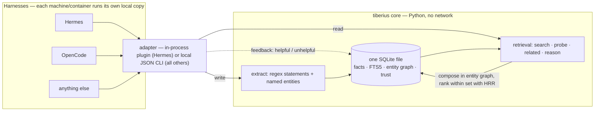

# Tiberius Memory

[](LICENSE)
[](pyproject.toml)
[](.github/workflows/tests.yml)

Local SQLite memory engine: structured facts, FTS5 search, entity graph, trust scoring, and
HRR-based compositional retrieval. Harness-agnostic core with one adapter per harness —
**no network, no service**: every harness runs the engine locally against its own DB file.

Tiberius is a fork of [hermes-plugin-holographic](https://github.com/NousResearch/hermes-plugin-holographic)
(Nous Research, MIT) — the HRR core is kept, but it is decoupled from a single harness: it runs
in-process under Hermes, and over a local CLI under OpenCode (and any other harness). See
[What's changed](#whats-changed-vs-upstream).

## A note on provenance

Tiberius was developed alongside a local LLM (an AI coding agent) and human
review. The whole codebase is ~1,500 lines across six files — small enough
to read in one sitting — and every push is gated in CI by a 32-test core
suite, 9 plugin unit tests, and an 18-query golden recall eval. But it will
store **your personal memory**: read the code and verify the parts you rely
on before you trust it with your data.

## Why this exists

- **Completely local.** Everything lives in one SQLite file on your machine. No network calls,
  no cloud, no API keys, no telemetry — your memory never leaves the box.
- **Free.** MIT-licensed, stdlib-only core (NumPy optional), nothing to bill per token or
  per seat.
- **Multiple harnesses, one memory model.** A single harness-agnostic core with one thin
  adapter per harness (Hermes in-process, OpenCode native plugin, anything else over a local
  CLI). Each harness keeps its own DB file — there is no central memory server to point
  containers at.
- **A real retrieval bug fixed.** The upstream HRR algebra could not compose queries across
  entities (see [What's changed](#whats-changed-vs-upstream)); that fix plus a
  golden-query eval gate is the reason the fork exists.

## How it works

Two paths over one local SQLite file: the **write path** extracts statements
and named entities from session content into the store; the **read path**
composes results in the SQL entity graph (which facts connect which
entities) and ranks within that set with HRR phase-vector similarity when
NumPy is available — without it, FTS5 + keyword scoring only.



Files:

- `store.py` — fact store (SQLite + FTS5), entity extraction, regex statement extraction
- `retrieval.py` — search / probe / related / reason (SQL entity graph composes, HRR ranks within set)
- `holographic.py` — HRR phase-vector algebra (numpy optional; without it, keyword mode)
- `provider.py` — Hermes `MemoryProvider` adapter (in-process plugin)
- `cli.py` — generic entrypoint for every other harness (`python3 -m tiberius.cli`)
- `opencode/` — native OpenCode V2 TypeScript plugin (wraps the CLI locally)
- `eval/` — golden-query recall harness (18 queries over a committed synthetic fixture; CI runs it on every push)

## What's changed vs upstream

- **HRR algebra fix**: fact vectors are lossy bundles of content + entity parts, so unbinding a
  phase key from a bundle is meaningless. Composition (probe/related/reason) now happens in the
  SQL entity graph; HRR only ranks within the composed set.
- **Compositional `reason()`**: facts connecting multiple named entities, ranked by shared-entity
  count — the query class the upstream could not answer at all.
- **Standalone core**: `store.py`/`retrieval.py`/`holographic.py` have no hard dependency on any
  harness (stdlib-only fallbacks; numpy optional).
- **Harness adapters**: `provider.py` (Hermes, in-process), `cli.py` (generic JSON CLI),
  `opencode/` (native OpenCode V2 plugin with per-session context injection and session-end
  extraction).
- **Quality gates**: a 32-test core suite, 9 plugin unit tests, Hermes-provider
  tests (need a Hermes environment), and an 18-query golden recall eval (`eval/`)
  that any retrieval change must not regress (fixture baseline recall@1 18/18,
  recall@3 18/18).

## Prerequisites

**Python 3.11+** — required for both harness paths (Hermes runs on it; the
OpenCode plugin shells out to `python3`). CPython ships the `sqlite3` module,
which is the engine Tiberius reads and writes with — **there is no separate
SQLite to install**: the store is a file, not a service.

Getting Python, if you don't have it:

- macOS: `brew install python`
- Debian/Ubuntu: `sudo apt install python3`
- OpenCode container: make sure `python3` is in the image (e.g.
  `apt-get install -y python3`)

Verify: `python3 -c "import sqlite3; print(sqlite3.sqlite_version)"`

Optional:

- **NumPy** — `pip install numpy`. Without it the engine degrades to keyword
  mode (FTS5 + Jaccard; entity composition still works via SQL, HRR reranking off).
- **`sqlite3` CLI** — only if you want to inspect the DB without Python
  (the [Your data](#your-data) snippet works with stdlib alone):
  macOS ships it; Debian/Ubuntu `sudo apt install sqlite3`; Alpine `apk add sqlite`.

## Hermes

Hermes discovers plugins by scanning `$HERMES_HOME/plugins/` (default `~/.hermes/plugins/`)
for a directory with a `plugin.yaml`. `name: tiberius` in that file is the identifier;
`provider.py` implements the `MemoryProvider` contract, which is what `hermes memory
setup` lists.

```bash
git clone https://github.com/Greg-GB/tiberius ~/.hermes/plugins/tiberius
```

Enable it in `config.yaml`:

```yaml
plugins:
  enabled: [tiberius]
```

Then pick it as your memory provider:

```bash
hermes memory setup    # select "tiberius"
```

Config in `config.yaml` under `plugins.tiberius`:

| Key | Default | Description |
|-----|---------|-------------|
| `db_path` | `$HERMES_HOME/tiberius_store.db` | SQLite database path |
| `auto_extract` | `false` | Auto-extract facts at session end |
| `default_trust` | `0.5` | Default trust score for new facts |
| `hrr_dim` | `1024` | HRR vector dimensions |

### Uninstall

1. Remove `tiberius` from `plugins.enabled` in `config.yaml` — and switch the
   memory provider first (`hermes memory setup`) if tiberius is the active one.
2. Delete the clone: `rm -rf ~/.hermes/plugins/tiberius`.
3. Restart the gateway so it stops loading the plugin.
4. **The database stays.** Uninstalling only stops Hermes reading and writing —
   the file at `db_path` (default `~/.hermes/tiberius_store.db`) is untouched.
   Keep it as a backup, or delete it if you want the memory gone.

## Your data

The store is a single SQLite file, created automatically on first use —
nothing to install or provision. Where it lives:

| Harness | Default location | Override |
|---------|------------------|----------|
| Hermes | `$HERMES_HOME/tiberius_store.db` | `plugins.tiberius.db_path` in `config.yaml` |
| OpenCode | `~/.tiberius/memory.db` | `options.db` in `opencode.json` |

To move your memory, move the file. To back it up, use SQLite's backup API
(`sqlite3 source.db ".backup dest.db"`, or Python's `sqlite3` `backup()`
method) or copy while the agent is idle — a plain file copy of a live
WAL-mode DB can miss the most recent writes. To inspect it, use any SQL
tool — no `sqlite3` CLI needed; Python's stdlib (a requirement anyway) does
it.
Node.js users: the file is plain SQLite in WAL mode — open it directly
(e.g. with `better-sqlite3`, read-only) for standard SQL and FTS5 queries;
full retrieval quality (HRR reranking) lives in the Python CLI.

```bash
python3 -c "
import sqlite3
for r in sqlite3.connect('tiberius_store.db').execute(
        'SELECT fact_id, content, trust_score FROM facts ORDER BY fact_id DESC LIMIT 10'):
    print(r)
"
```

## OpenCode (native V2 plugin)

`opencode/index.ts` is a native OpenCode V2 plugin. Every operation shells out
to the Python CLI in a local subprocess — the core never runs inside the node
process, and nothing crosses the network. **Runtime-verified against live
OpenCode 2.0.28** (2026-10-26): all six tools, context injection, and
session-end extraction were observed working end-to-end; the verified payload
shapes are documented in [`ARCHITECTURE.md`](ARCHITECTURE.md).

### Install

```bash
# 1. get the repo — it must live on the same host/container as OpenCode
git clone https://github.com/Greg-GB/tiberius /opt/tiberius

# 2. python3 with stdlib sqlite3 (see [Prerequisites](#prerequisites))
python3 -c "import sqlite3; print(sqlite3.sqlite_version)"

# optional: HRR reranking (the engine degrades to keyword mode without it)
pip install numpy
```

Smoke-test the engine directly before wiring the plugin (the repo's parent
must be on `PYTHONPATH` — the same requirement the `pythonpath` option
handles):

```bash
PYTHONPATH=/opt python3 -m tiberius.cli --db /opt/tiberius/memory.db add "tiberius smoke test"
PYTHONPATH=/opt python3 -m tiberius.cli --db /opt/tiberius/memory.db search "smoke"
```

Both print JSON; the search should find the fact you just added. Remove it
again with `remove <fact_id>` when you're done.

Then add a plugin entry to OpenCode's config — either the global
`~/.config/opencode/opencode.json` or a project-level `opencode.json` next to
your project:

```jsonc
{
  "plugins": [{
    "package": "file:///opt/tiberius/opencode",   // local directory (npm/GitHub packages work too)
    "options": {
      "db": "/opt/tiberius/memory.db",      // default: ~/.tiberius/memory.db
      "pythonpath": "/opt"                  // only if `tiberius` isn't importable yet: the repo's PARENT
    }
  }]
}
```

Restart OpenCode — or just wait: plugin files and config hot-reload without a
restart.

### Options

| Key | Default | Description |
|-----|---------|-------------|
| `db` | `~/.tiberius/memory.db` | SQLite database file (created on first use) |
| `engine` | `["python3", "-m", "tiberius.cli"]` | argv used to launch the engine |
| `pythonpath` | inherited from the environment | `PYTHONPATH` for the engine; set it to the repo parent so `python3 -m tiberius.cli` resolves |
| `injectTop` | `4` | facts injected into the system prompt at session start |

### What the agent gets

- **Six tools**: `memory_search` / `memory_probe` / `memory_related` /
  `memory_reason` / `memory_add` / `memory_feedback` — the same operation
  surface as the Hermes provider.
- **Context injection**: on the session's first model call, the top
  `injectTop` facts relevant to the latest user message are appended to the
  system prompt; later turns rely on the tools.
- **Session-end extraction**: when an execution succeeds (or is interrupted),
  statements like "I prefer X" / "the project uses Y" are regex-extracted from
  the user's messages. Idempotent — facts dedupe on exact content, so
  re-running per completed turn is safe.
- **A usage skill**: `skills/tiberius-usage/SKILL.md` teaches the agent how
  to recall, store, and rate facts well. OpenCode does not auto-discover the
  repo's `skills/` directory — register it in `opencode.json`:

  ```jsonc
  { "skills": ["/opt/tiberius/skills"] }   // absolute path to the repo's skills dir
  ```

### Data and persistence

The store is a single SQLite file (WAL mode) at `options.db` (default
`~/.tiberius/memory.db`). **Put it on persistent storage** — if the file lives
on ephemeral container storage, memory dies with the container. Multiple
OpenCode instances on the same host may share one file: SQLite serializes
writers behind a 10s busy timeout.

### Failure modes

Memory must never break model dispatch: every engine call has a 30s timeout
and is caught. Tool calls return `{"error": ...}` when the engine fails
(including the CLI's own structured errors, e.g. feedback on an unknown
`fact_id`); context injection and extraction simply skip. In-flight engine
subprocesses are killed when the plugin unloads, so a restart can't leave a
python process holding the DB write-lock.

### Uninstall

1. Remove the plugin's `plugins` entry — and its `skills` entry, if you
   registered it — from `opencode.json`. The config hot-reloads, so the
   agent loses the `memory_*` tools without a restart.
2. Optionally delete the repo clone (e.g. `rm -rf /opt/tiberius`).
3. **The database stays.** Uninstalling only stops the agent reading and
   writing — the file at `options.db` (default `~/.tiberius/memory.db`) is
   untouched. Keep it as a backup, or delete it if you want the memory gone.

### Development

```bash
cd opencode && npm ci && npm run typecheck && npm test
```

## Any other harness

The repo dir must be importable as package `tiberius` (its parent on `PYTHONPATH`), then:

```bash
python3 -m tiberius.cli --db PATH search "query" [--top N]
python3 -m tiberius.cli --db PATH probe "entity"
python3 -m tiberius.cli --db PATH related "entity"
python3 -m tiberius.cli --db PATH reason "a" "b"
python3 -m tiberius.cli --db PATH add "fact" [--category C] [--tags a,b]
python3 -m tiberius.cli --db PATH feedback <id> helpful|unhelpful
python3 -m tiberius.cli --db PATH remove <id>
echo '[{"role":"user","content":"..."}]' | python3 -m tiberius.cli --db PATH extract
```

DB path: `--db` > `$TIBERIUS_DB` > `~/.tiberius/memory.db`. All output is JSON.

### For agents

The tool descriptions say what each operation does;
[skills/tiberius-usage/SKILL.md](skills/tiberius-usage/SKILL.md) says how to
use them *well* — when to recall, what to store, and the feedback loop that
keeps the store accurate. Install it by copying the file into your agent's
skills directory (or referencing it from your agent instructions).

## Contributing

See [CONTRIBUTING.md](CONTRIBUTING.md) — the one rule that matters: retrieval
changes must not regress the golden eval (fixture baseline recall@1 18/18, recall@3 18/18).
AI coding agents: [AGENTS.md](AGENTS.md). Security policy and what counts as a
vulnerability in a local-memory project: [SECURITY.md](SECURITY.md).

## Development

Core tests (`test_tiberius_store`, `test_tiberius_retrieval`, `test_tiberius_cli`) need nothing
beyond Python 3.11+ and pytest; provider tests additionally import Hermes core. Retrieval
quality is gated by the golden eval: `python eval/run_eval.py` runs the committed
synthetic fixture (fixture baseline recall@1 18/18, recall@3 18/18); pass a DB path to
eval against your own live store: `python eval/run_eval.py /path/to/your.db`. CI runs
the core suite + fixture eval on every push.

Deep-dive for anyone changing the code — data model, HRR algebra (and the bundle
rule), retrieval flows, concurrency rules, and the pitfall list:
[ARCHITECTURE.md](ARCHITECTURE.md).
